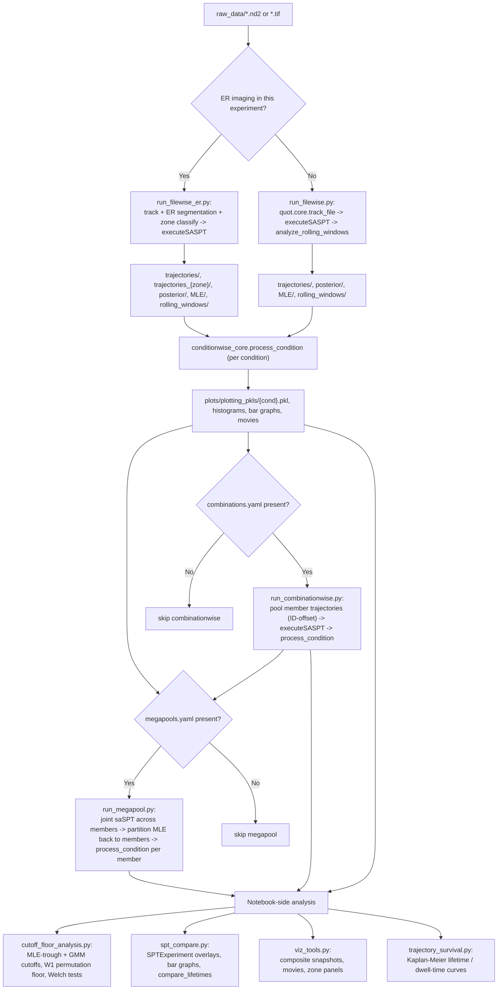

# SPT Analysis Flow-Chart

Reference map of how raw imaging data moves through the pipeline to
publication-quality figures. This is the durable, in-repo version of a mental
model that had mostly lived in prior chat transcripts — verify against the
live code (`2025_gavin_scripts/quot_saspt_workflow/`, `ER_SPT/2026_05_26/`) if
anything here looks stale; see CLAUDE.md §0 ("read deployed files before
assuming").

## Diagram



## Decision gates

- **ER branch (node B):** determined by which filewise entry point you invoke,
  not a runtime flag — `run_filewise.py` for a plain experiment,
  `run_filewise_er.py` for one with an ER channel. The ER branch is **not a
  fork** of the general pipeline: it reuses the same
  conditionwise/combinationwise/megapool machinery downstream. The only
  structural difference is that `combination_functions.py` accepts a `zone`
  parameter that redirects trajectory pooling to read from
  `trajectories_{zone}/` instead of the canonical `trajectories/` (CLAUDE.md
  §5).
- **`combinations.yaml` (node H):** if present at the experiment root,
  `analyze_directory.py` submits one combinationwise SLURM job per entry, with
  `afterok` dependencies on each member condition's filewise array job
  (CLAUDE.md §6).
- **`megapools.yaml` (node K):** if present, one megapool job per entry, with
  `afterok` dependencies on both member filewise array jobs and member
  combinationwise jobs. **See `docs/MEGAPOOL.md` for the full architecture,
  `megapools.yaml` schema, memory/time scaling table, and troubleshooting** —
  not duplicated here.

## Where the hard-won gotchas bite (CLAUDE.md §8 cross-reference)

- **Node O (cutoff detection):** GMM+MLE hierarchy — MLE troughs are primary,
  GMM (immobile-spike-excluded) confirms each trough individually. Never
  invert this.
- **Nodes I/L (combinationwise/megapool):** the joint-fit MLE_D shift
  (~+0.16 log10 vs per-FOV fit) applies here — mechanism undetermined, do not
  call it a "known saSPT pathology."
- **Nodes E2/D (ER zone classification):** positive label definitions
  (`off_ER` must be ≥95% spatial purity outside the broad mask, not a
  catch-all residual) and the binomial-test power caveat (`n_min_binom`
  computed per-FOV) both apply before trusting a zone assignment.
- **Node N → any (`orig_trajectory` recovery):** preserved 1:1 only when
  `saspt.sample_size >= pool size`. Megapools force `sample_size = 1e9`;
  per-condition/combo runs use the default 100k cap and may drop the mapping
  for some trajectories.

## Standard notebook workflow (viz_tools.py)

```python
import sys
sys.path.insert(0, "/path/to/ER_SPT/2026_05_26")  # or wherever viz_tools.py lives
import viz_tools as vt
import importlib

# after any edit to viz_tools.py:
importlib.reload(vt)
# do NOT `from viz_tools import *` after reload — it leaves stale function
# references bound in the notebook namespace (CLAUDE.md §7).
```

`spt_compare.SPTExperiment` follows the same import/reload pattern for
condition/combo/megapool comparison plots — point it at a
`plots/plotting_pkls/` (or `plots/megapool_{name}/plotting_pkls/`) directory
and it discovers conditions from the PKLs there.

## Output tree reference

Under `tracking_output_q=<quality>/` (auto-created):

```
trajectories/, trajectories_{zone}/ (ER only)
posterior/, MLE/, rolling_windows/, subtrack_posteriors/ (optional)
*_combinations/ and *_megapools/ mirrors of the above
plots/plotting_pkls/            per-condition and per-combo PKLs
plots/megapool_{name}/plotting_pkls/   per-megapool-member PKLs
movies/, settings.pkl
```
